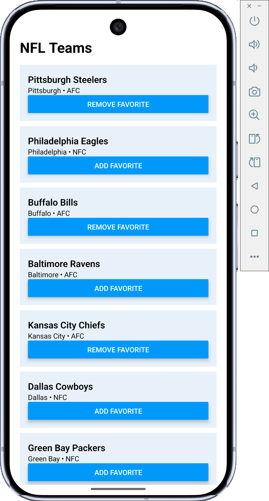

# Module 9 Lab - NFL Team Explorer

**Sam Alawadhi**

## Screenshot

## Explanation of useEffect, FlatList, and AsyncStorage

useEffect is used to load the team list and reload saved favorites when the app reopens. In the meantime, the loading indicator appears. The FlatList displays the teams in a list that the user can scroll through and uses each team’s ID as the key. AsyncStorage only saves the favorite teams based on their IDs. I used JSON.stringify() to save the IDs as a string and JSON.parse() to turn them back into an array when the app reopens.

The code would change if the teams came from an HTTP API because instead of a local JSON file,I would use a GET request using fetch(). Then, I would check that the response succeeded, read `data.teams` from the JSON response, and show an error if the request failed. The list and favorite buttons would work the same way.