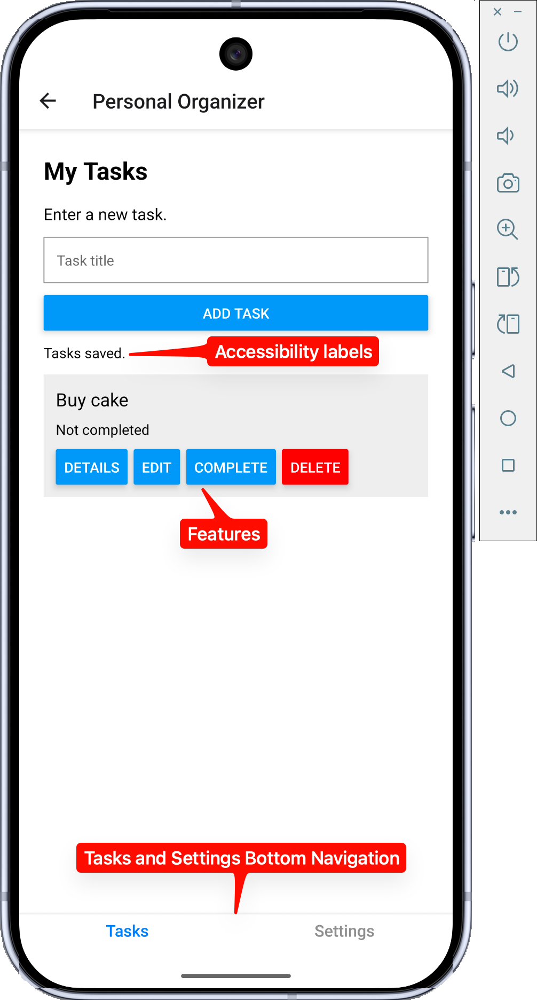
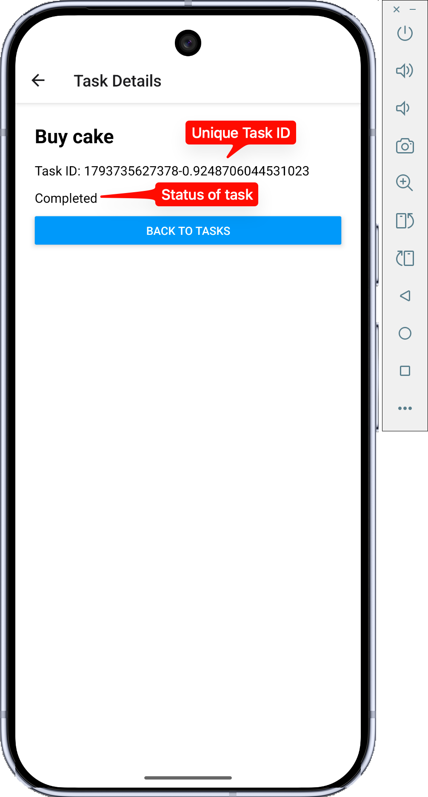
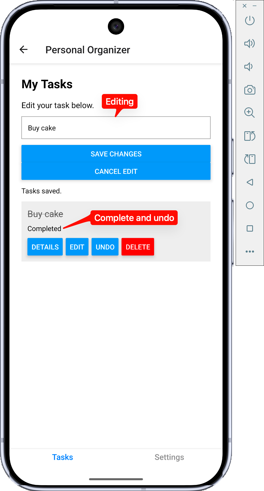
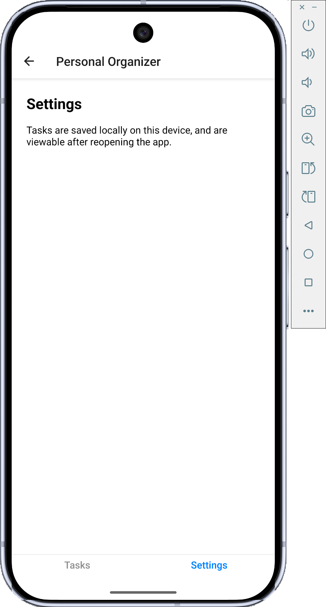

# Module 8 Assignment - Personal Organizer

**Sam Alawadhi**

## App Description

This is a React Native application created for managing tasks.
Users can add, view, edit, complete, and delete tasks. Tasks remain
saved after closing and reopening the app, and each task is associated with a unique Task ID.

## Implemented Features

- Home, Tasks, Task Details, and Settings screens.
- Stack navigation and bottom tabs for Tasks and Settings.
- A form for adding and editing task titles.
- Validation that rejects blank or whitespace-only titles.
- Task completion and the ability to mark tasks incomplete.
- Confirmation before deleting a task.
- Persistent storage with AsyncStorage.
- Loading, save success, save failure, and empty-state feedback.
- A reusable FormField component.
- Accessibility labels on interactive controls.
- TypeScript types for tasks and navigation parameters.

## Installation and Run Instructions

1. Install Node.js, VS Code, and Android Studio.
2. Create and start an Android emulator through Device Manager.
3. Open the project folder in VS Code and run:

   ```bash
   npm install
   npx run android
   ```

## How AsyncStorage Is Used

Tasks are stored locally under `organizer_tasks`.

When the app opens, useEffect retrieves the saved information.
JSON.parse() converts the stored string into a task array.
Another useEffect saves the array with JSON.stringify() whenever
tasks change.

## Navigation and Reusable Component

The stack contains Home, the main tab area, and Task Details.
The tab area contains Tasks and Settings.

The FormField component is reused for every task in the list. It displays the task
and provides Details, Edit, Complete/Undo, and Delete buttons.

## Screenshots

### Home Page
 

### Tasks


### Details


### Editing


### Settings
