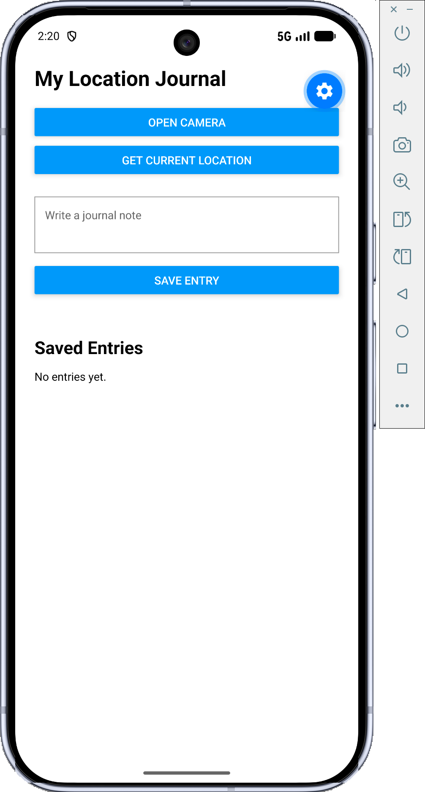
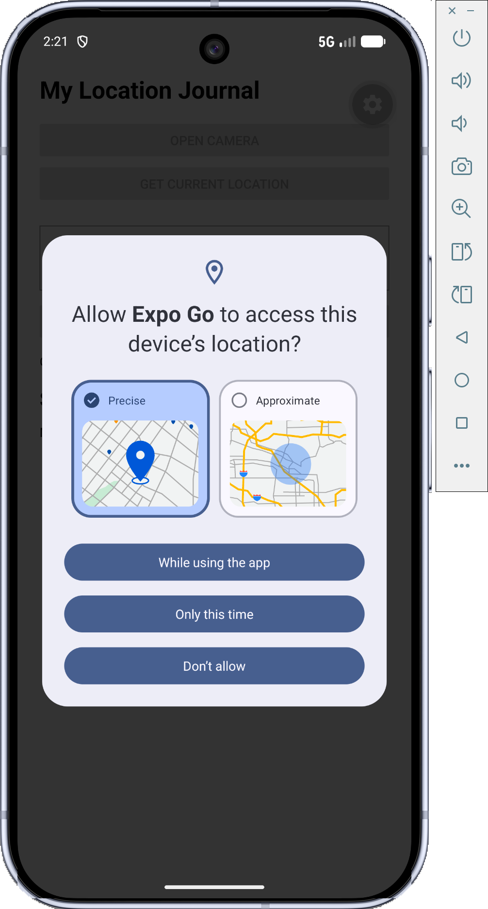
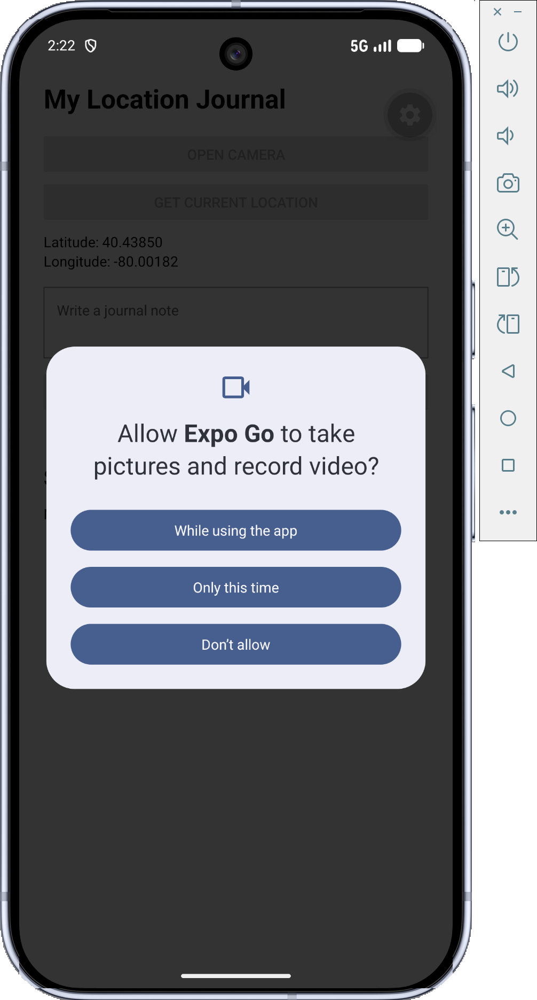
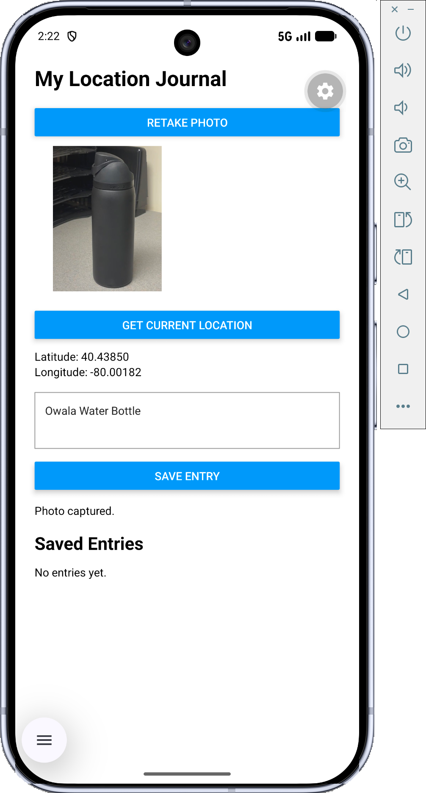
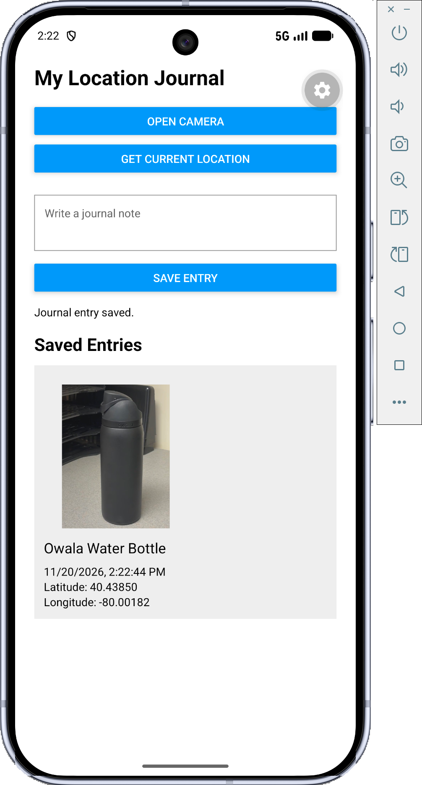

# Module 10 Assignment - My Location Journal

**Sam Alawadhi** 

## App Description

A React Native app that allows users to capture a photo, attach their current coordinates, write a note, and save a timestamped journal entry.
Saved entries appear in a scrollable list and remain present after restarting.

## Installation and Run Instructions

Install these dependencies:

```bash
npx expo install expo-camera expo-location expo-file-system @react-native-async-storage/async-storage
```
To run the application:

1. Install Node.js and start an Android emulator in Android Studio.
2. Open the project folder in VS Code and run:

   ```bash
   npm install
   npx expo start
   ```
3. Press `a` to open the project on Android.

## Screenshots

**Home**



**Location Permissions**



**Camera Permissions**



**Editing the Journal**



**Journal List**



## Reflection

One challenge I faced during this assignment was getting photos to actually display in the application. At first, the camera would show a simulated scene created by the emulator for testing reasons. However, whenever I took the photo, it would return a black image with a time stamp on the photo. It took a while to figure out how to fix this issue, but I changed the camera path in the Android Emulator to be the webcam of my computer. After a change to `launchCameraAsync`, the app now opens a camera window instead of an in-app viewfinder, which seems to have fixed it.

As for permissions, the app requests camera permission when pressing the "Open Camera" button and location permission when pressing the "Get Current Location" button. If permission is denied, it displays an error message instead of continuing.

For privacy, the app does not upload entries anywhere or collect location details in the background. Even though entries aren't being uploaded to the cloud, local storage is not automatically encrypted. I used pre-set coordinates that point to a general area of Point Park's campus and nonsensitive images during testing.