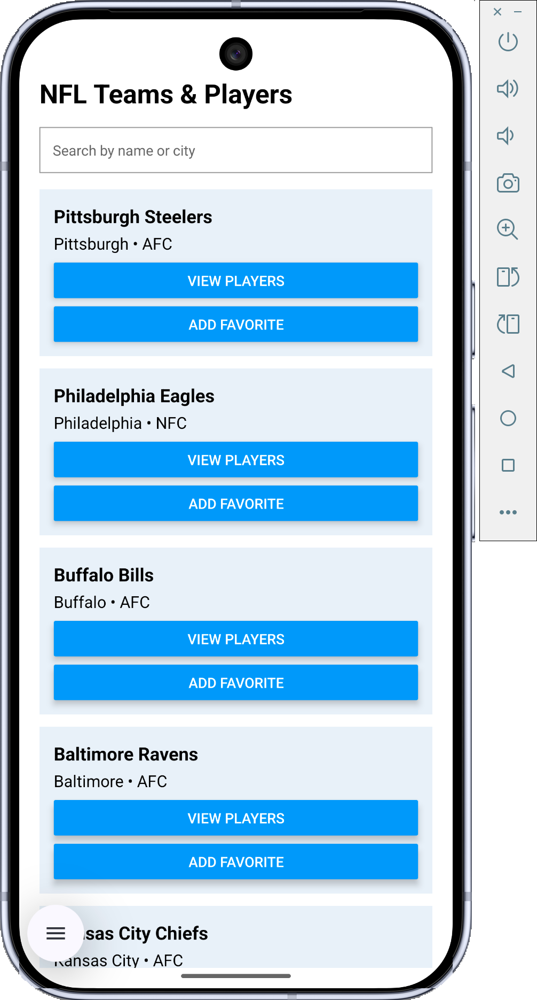
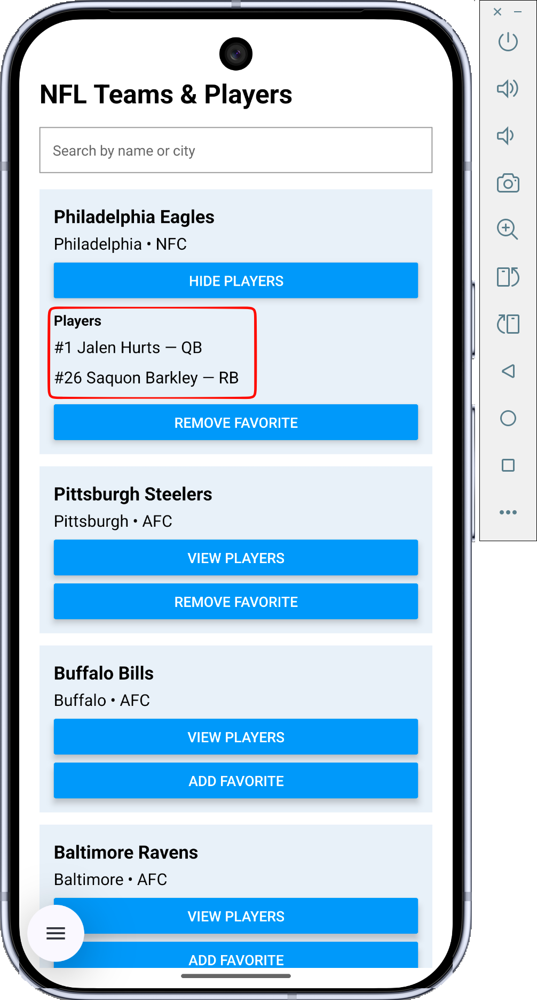
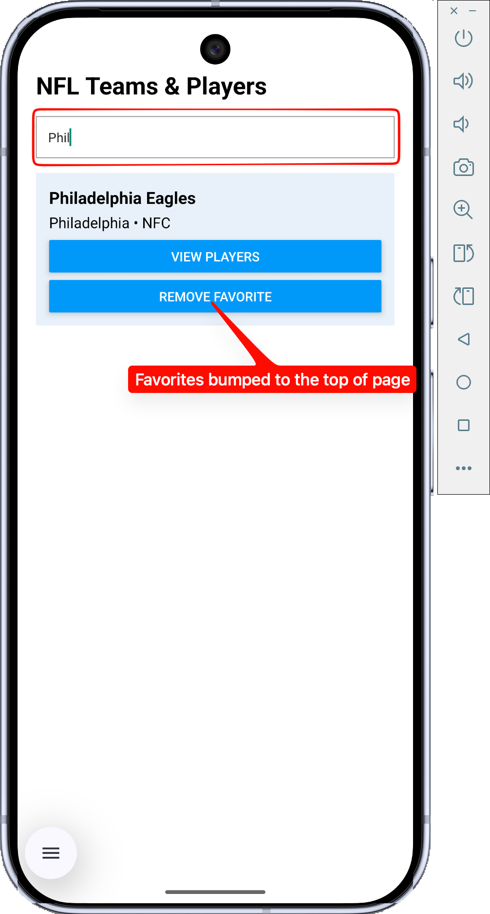

# Module 9 Assignment NFL Teams & Players

**Sam Alawadhi** 

## App Description

A React Native app for browsing 10 NFL teams, viewing players, searching by team name or city, and saving favorite teams.

## Installation and Run Instructions

1. Install Node.js and start an Android emulator in Android Studio.
2. Open the project folder in VS Code and run:

   ```bash
   npm install
   npm run android
   ```

## Data Source

The app uses a local JSON file located in `data/teams.json`. It includes real NFL team names, cities, and conferences. Each team has two players from the 2024 season with a name, position, and jersey number.

## Screenshots

**Team list**



**Players**



**Favorites and search**



## Reflection

For this assignment, the application is built based on a local JSON file. I used players from the 2024 NFL season so I could practice displaying names, positions, and jersey numbers. A reusable `TeamCard` component shows the same layout for every team, and `FlatList` displays the cards in a scrollable list.

React state is used to keep track of the search text, the team card, and the favorite team by IDs. Typing in the search box filters the list by name or city. Selecting `View Players` changes which team is open so the user can see its players without leaving the list.

I used AsyncStorage to save the favorite IDs on the device. `JSON.stringify()` turns the IDs into a string before saving them. When the app reopens, `useEffect` reads that string and `JSON.parse()` turns it back into an array.

If I wanted to use a live API, I would need an endpoint with team and player data. If I had that source, I would use `fetch()` to make a GET request, check the response, and store the results in state.

## AI Assistance

I used ChatGPT to come up with the JSON file (I'm not familiar with football), debug, and organize the README.