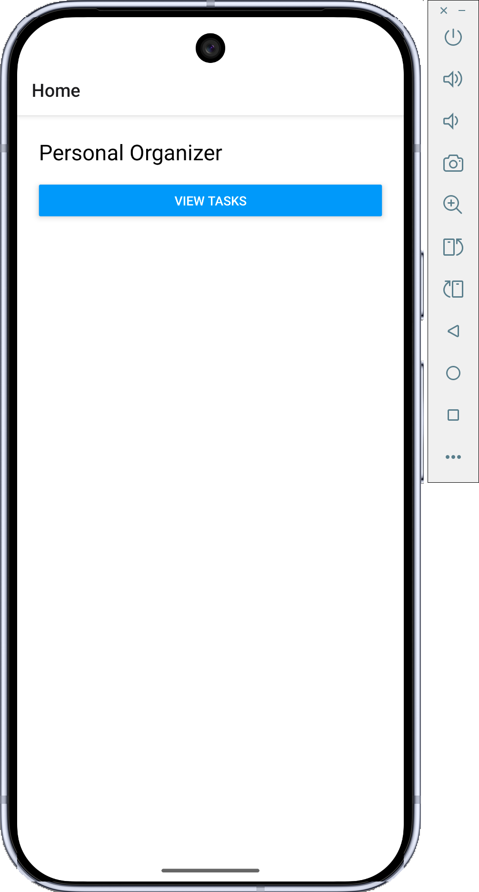
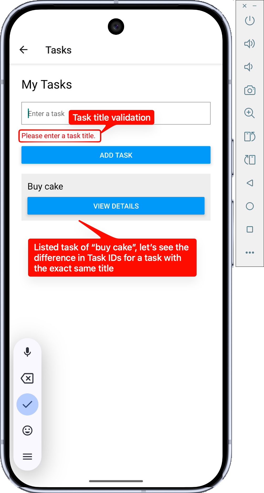
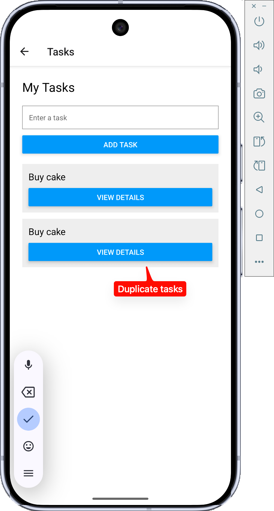
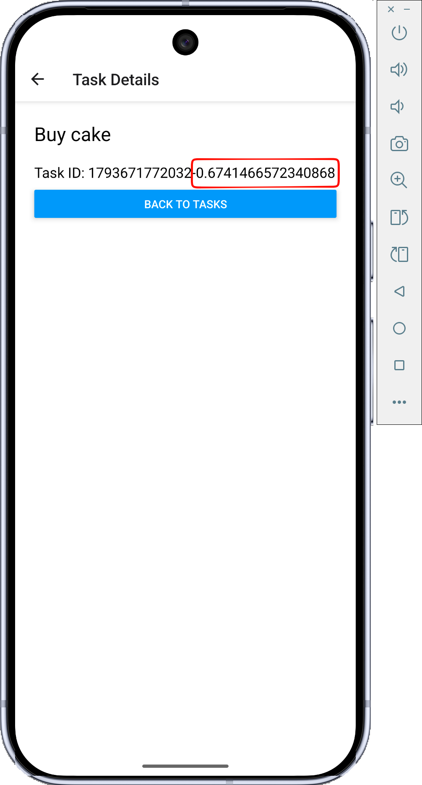
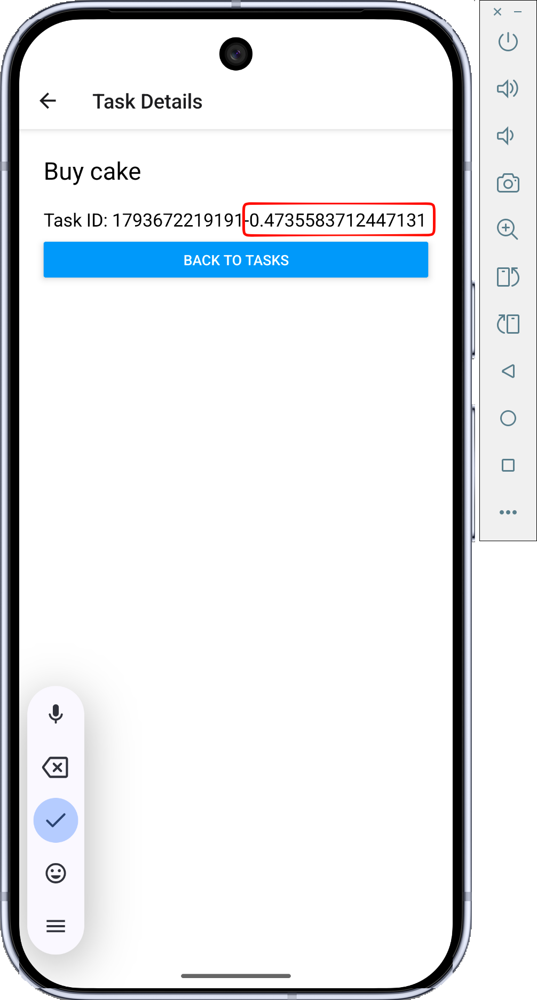

# Module 8 Lab Assignment - Task Manager

**Sam Alawadhi**

## App Description

This React Native application is used adding, viewing, and deleting tasks. It includes Home, Tasks, and Task Details screens, with input validation to prevent empty task titles.

## Implemented Features

- Home, Tasks, and Task Details
- Task entry form
- Task title validation
- Task ID navigation parameter
- Empty state message
- Navigational support
- Consistent screen layouts
- Readability

## Installation and Run Instructions

1. Install Node.js, VS Code, and Android Studio.
2. Create and start an Android emulator using Android Studio’s
   Device Manager.
3. Open the project folder in VS Code and run:

   ```bash
   npm install
   npx run android
   ```
## Screenshots

### Home Page


### Validation


### Duplicate Tasks


### Task 1


### Task 2
