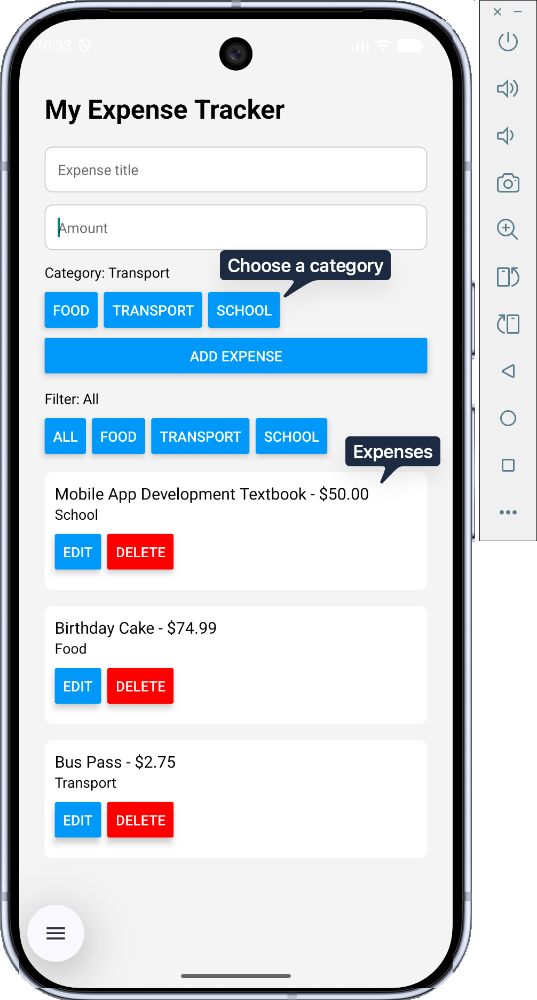
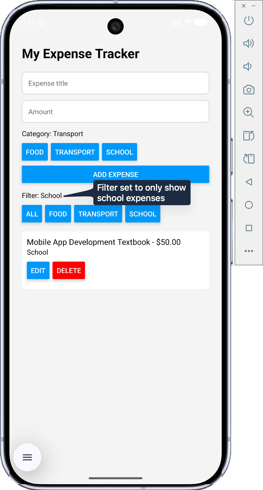
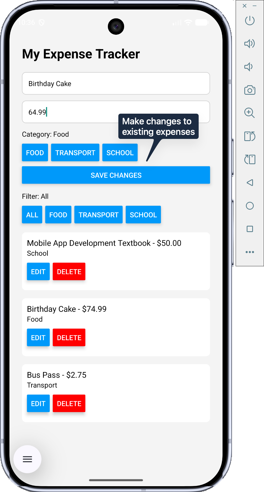
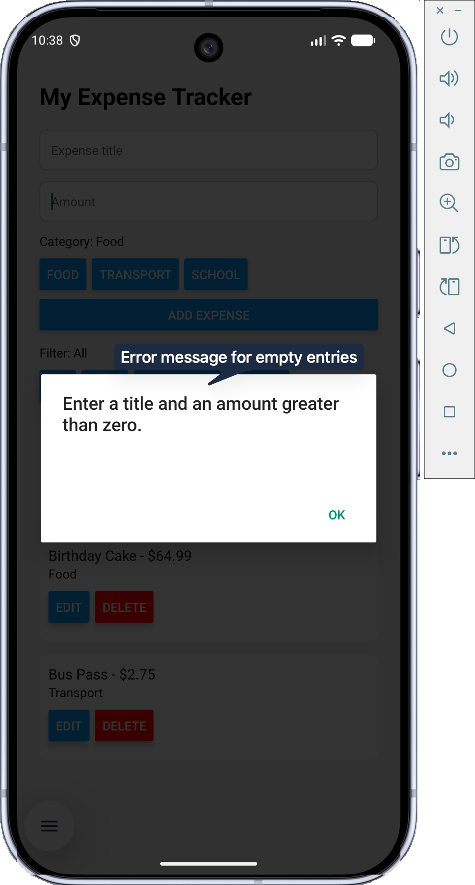

# Module 7 Homework Assignment - Personal Expense Tracker

**Sam Alawadhi**

## App Description

This React Native application is used for recording personal spending. Each expense includes a description, amount, and category. Expenses are saved on the device between sessions.

## Implemented Features

- Add expenses through a form.
- Display expenses using FlatList.
- Edit the description, amount, and category.
- Delete expenses.
- Support 3 categories: Food, Transport, and School.
- Filter by category or display all expenses.
- Error message for blank descriptions and invalid amounts.
- Save and reload expenses using AsyncStorage.

## Installation and Run Instructions

1. Install Node.js, VS Code, and Android Studio.
2. Create and start an Android emulator using Android Studio’s
   Device Manager.
3. Open the project folder in VS Code and run:

   ```bash
   npm install
   npx run android
   ```

## How AsyncStorage Is Used

AsyncStorage saves the expenses locally using `personalExpenses`.

JSON.stringify() converts the expenses array into a string before
saving. When the app opens, useEffect retrieves the saved information.
JSON.parse() converts it back into an array and updates state.

A second useEffect saves changes when expenses are added, edited,
or deleted. This allows expenses and changes to remain available after the
app closes and reopens.

## Screenshots

### Main Page


### Filters


### Editing


### Error Message
